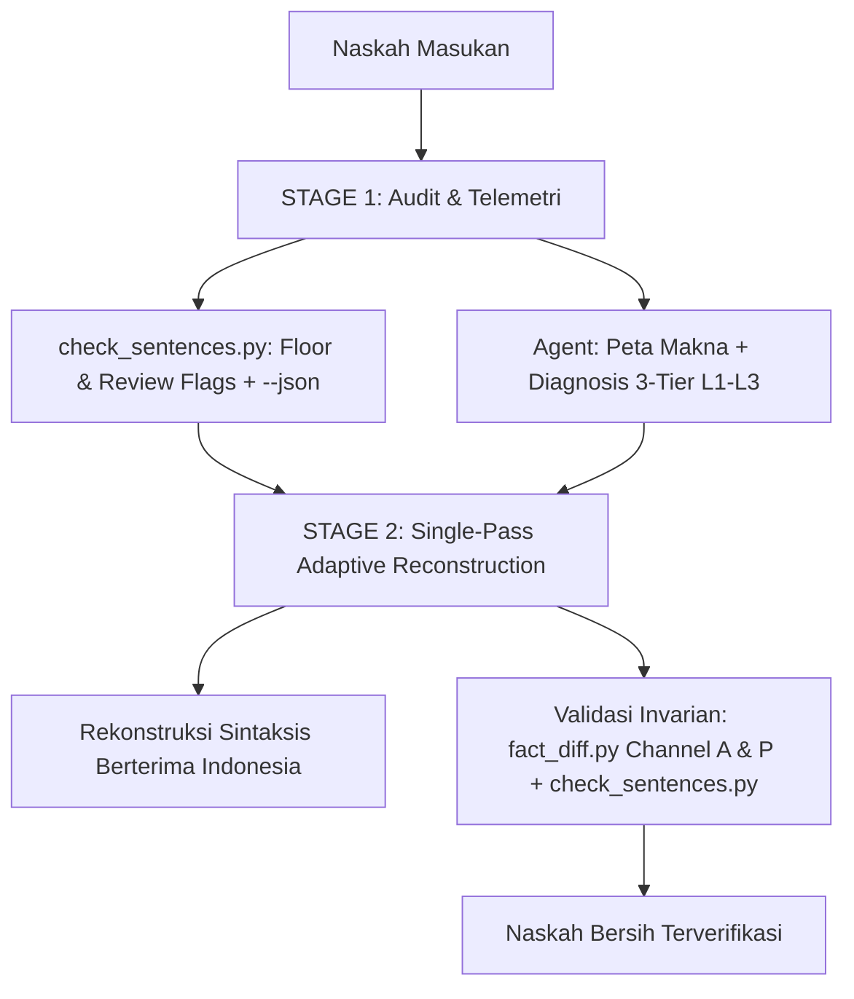

# Metode Anti-Translationese untuk Prosa Indonesia

Rasional, basis bukti, dan taksonomi diagnostik hierarkis untuk menyunting prosa Indonesia agar bebas *translationese* — pola kalimat, idiom, penanda wacana, dan urutan gagasan yang secara sistematis menyerupai teks hasil mediasi bahasa sumber (terutama bahasa Inggris), bukan bahasa Indonesia yang sejak awal dikarang penutur asli.

Dokumen ini adalah **spesifikasi dan rasional teoretis**; kontrak workflow operasionalnya hidup di skill `anti-translationese` (`.agents/skills/anti-translationese/`).

Metode ini turunan dari diagnosis mekanisme di [[2026-07-16-translationese-sastrawi-bahasa-non-english]] dan rancangan empiris di `my-articles/llm-translationese-behavior.md`: model LLM memproses representasi di ruang laten yang didominasi bahasa Inggris, lalu merender ke bahasa Indonesia. Dalam kondisi default atau prompt sastra, model rentan mengaktifkan *template* generik bahasa sumber daripada konvensi autentik bahasa Indonesia.

---

## 1. Prinsip Pengatur: Makna Memimpin, Mesin Menjaga, Native Mengesahkan

Aturan mekanis mengoptimalkan **proksi** (jumlah kata, pengulangan token), bukan **makna**. Memaksa proksi secara membabi-buta merusak prosa (Hukum Goodhart): plafon panjang yang kaku menghasilkan kalimat pendek yang terputus rantai kausalitasnya, staccato, dan hampa. Skrip tidak dapat membaca apakah "dr" dan "dokter" adalah satu rujukan, atau apakah kalimat B masih mengalir logis dari A. Hanya nalar yang bisa memahami proposisi. Namun, nalar model pun rentan luput pada kalimat kepanjangan dan self-audit internal.

Karena itu, beban kerja dibagi menjadi tiga peran:

* **Agent (Memimpin) — Pemilik MAKNA**: Memahami proposisi, rantai kausal/temporal, dan relasi aktor; menjaga, menjembatani, dan merekonstruksi kalimat. Agent menggerakkan setiap keputusan suntingan.
* **Checker Script (Pembantu) — Penjaga PERMUKAAN & Telemetri**: Menandai cacat objektif (panjang kalimat melampaui batas, staircase kasar, repeat-opener, kata terlarang kaku) serta menyajikan peringatan *advisory* (kepadatan kata fungsi, konstruksi *cleft*, kepadatan demonstrativa). Ini adalah detektor asap, bukan penentu eksekusi.
* **Native Reader (Pengesah) — Validasi Akhir**: Mengesahkan kelayakan register dan ritme alami.

> **Makna mengalahkan metrik.** Semua tanda dari skrip (termasuk batas panjang) boleh di-override oleh agent dengan alasan berbasis makna. Status Exit-0 pada skrip hanyalah lantai minimal permukaan, bukan bukti bahwa penyuntingan telah selesai.

---

## 2. Empat Invarian yang Wajib Dijaga

Penyuntingan mengubah **gaya dan struktur interferensi**, tanpa pernah merusak empat hal berikut:

1. **Fakta**: Entitas, tanggal, angka, kutipan, urutan peristiwa, dan sitasi identik (diverifikasi via `fact_diff.py`).
2. **Peta Makna**: Proposisi utuh + rantai sebab-akibat + relasi aktor + derajat kepastian (*hedging*). Mengurangi panjang tidak boleh membuang informasi atau mengubah klaim probabilitas menjadi kepastian mutlak.
3. **Ritme Fraktal**: Kurva tempo pada lima skala (intra-kalimat, antar-kalimat, intra-paragraf, antar-paragraf, dan busur wacana keseluruhan).
4. **Arsitektur Informasi**: Pesan berkembang dari yang sudah diketahui (*given*) menuju informasi baru (*new*) melalui pengungkapan progresif (*progressive disclosure*).

---

## 3. Gerbang Genre (Ditentukan per Paragraf)

Panjang kalimat adalah tuas kendali yang **bersyarat genre**, bukan hukum absolut:

* **Naratif / Adegan / Aksi** $\rightarrow$ Utamakan $\le 20$ kata. Penyakit utamanya adalah over-elaborasi sastrawi dan metafora abstrak; kalimat ramping dan tindakan konkret adalah obatnya.
* **Ekspositoris / Sinopsis / Analitis** $\rightarrow$ Plafon longgar ($\le 30$ kata). Klausa subordinatif (`yang`, aposisi berkoma, `ketika`, `sehingga`, `sedangkan`) adalah **alat asli bahasa Indonesia** untuk kepadatan dan kohesi konseptual. Jangan memenggal kalimat subordinatif bersih menjadi fragmen kopula pendek yang kaku. Tunduk pada [[prose-writing-style]] sebagai lapisan otoritatif.

---

## 4. Taksonomi Diagnostik Hierarkis (11 Kategori dalam 3 Tier Diperkokoh)

Taksonomi sebelas kategori dari `my-articles/llm-translationese-behavior.md` distrukturkan secara hierarkis ke dalam tiga tier operasional (L1, L2, L3) dengan penajaman morfosintaksis dan tuturan lisan:

```
┌─────────────────────────────────────────────────────────────────────────────┐
│                   TAKSONOMI DIAGNOSTIK ANTI-TRANSLATIONESE v4               │
├─────────────────────────────────────────────────────────────────────────────┤
│ TIER L1: LEKSIKAL, KOLOKASI, KATA FUNGSI & TUTURAN LISAN                    │
│   ├── CALQUE: Idiom beku terjemahan harfiah ("pada akhir hari" -> intinya)   │
│   ├── NONNATIVE-COLLOCATION: Pasangan kata artifisial ("legitimasi regional")│
│   ├── ANGLO-LITERARY-METAPHOR: Template sastra sumber ("sejarah menyaksikan")│
│   ├── FUNCTION-WORD-CARRYOVER: Paket preposisi boros ("dalam kaitannya dgn")│
│   ├── PRAGMATIC-DIALOGUE-CALQUE: Kalke percakapan/sulih suara ("dengar kawan")│
│   └── ASPECT-PLEONASM: Pleonasme aspek beruntun ("telah selesai", "sedang") │
├─────────────────────────────────────────────────────────────────────────────┤
│ TIER L2: SINTAKSIS, VALENSI, DIATESIS & STRUKTUR INFORMASI                  │
│   ├── AGENTIVE-PASSIVE-CALQUE: Pasif "di- oleh P1/P2" -> Pasif Tipe 2       │
│   ├── APPLICATIVE-VALENCY: Preposisi parasitik verba ("membahas tentang")   │
│   ├── ABSTRACT-SUBJECT: Subjek abstrak diberi agensi aktif manusia tak wajar│
│   ├── EXCESSIVE-NOMINALIZATION: Penumpukan kata benda tindakan beku         │
│   ├── SOURCE-SYNTAX-CARRYOVER: Kerangka klausa / modifier mengekor Inggris  │
│   └── SOURCE-INFORMATION-STRUCTURE: Konstruksi focus/cleft mekanis           │
├─────────────────────────────────────────────────────────────────────────────┤
│ TIER L3: WACANA, REFERENSI & ASIMETRI PRONOMINA-ANIMASI                     │
│   ├── SOURCE-DISCOURSE-PATTERN: Kisi konektor penanda wacana kaku/berulang   │
│   ├── SOURCE-REFERENCE-MAPPING: Obral penanda "sebuah" / "tersebut" mekanis  │
│   └── SOURCE-PRONOUN/ANIMACY: Pemetaan "it" -> "dia/ia" pada benda/sistem;   │
│        (Aturan: Tandai dia/ia nonmanusia; lindungi dia/ia insani & klitik nya)│
└─────────────────────────────────────────────────────────────────────────────┘
```

### Tabel Rincian Pola Diagnostik

| Tier | Kategori | Target Audit | Pola Translationese | Versi Native Indonesia |
|---|---|---|---|---|
| **L1** | `CALQUE` | Idiom/frasa beku sumber | *Dia membuat jalannya ke pintu.* | *Dia berjalan ke pintu.* |
| **L1** | `NONNATIVE-COLLOCATION` | Pasangan kata modern janggal | *Ongkos perbaikan ini adalah 2 file.* | *Perbaikan ini mengubah 2 file.* |
| **L1** | `ANGLO-LITERARY-METAPHOR` | Template citraan generik abstrak | *Kemerdekaan menemukan suaranya.* | *Rakyat menyuarakan kemerdekaan.* |
| **L1** | `FUNCTION-WORD-CARRYOVER` | Paket kata fungsi/preposisi | *dalam rangka untuk mencapai...* | *untuk mencapai...* |
| **L1** | `PRAGMATIC-DIALOGUE-CALQUE` | Kalke percakapan/sulih suara | *Jangan main-main denganku, kawan.* | *Jangan cari gara-gara.* |
| **L1** | `ASPECT-PLEONASM` | Tumpukan penanda aspek | *Proyek ini telah selesai dikerjakan.* | *Proyek ini selesai dikerjakan.* |
| **L2** | `AGENTIVE-PASSIVE-CALQUE` | Pasif agen P1/P2 asing | *Laporan telah disusun oleh saya.* | *Laporan sudah saya susun.* |
| **L2** | `APPLICATIVE-VALENCY` | Preposisi verba transitif | *Buku ini membahas tentang AI.* | *Buku ini membahas AI.* |
| **L2** | `ABSTRACT-SUBJECT` | Agensi aktif pada nomina abstrak | *Pengumuman itu menciptakan kepanikan.* | *Setelah pengumuman itu, warga panik.* |
| **L2** | `EXCESSIVE-NOMINALIZATION` | Tindakan dibekukan jadi nomina | *Pelaksanaan pembacaan menjadi penanda...* | *Soekarno membacakan..., lalu... dimulai.* |
| **L2** | `SOURCE-SYNTAX-CARRYOVER` | Struktur klausa mengekor sumber | *Dengan teks di tangannya, dia berdiri...* | *Dia membawa teks itu lalu berdiri...* |
| **L2** | `SOURCE-INFO-STRUCTURE` | Fokus cleft mekanis | *Apa yang membuat X penting adalah Y.* | *X penting karena Y.* |
| **L3** | `SOURCE-DISCOURSE-PATTERN` | Kisi transisi buatan | *Selain itu... Sementara itu... Di sisi lain...* | Biarkan kohesi logis mengalir alami |
| **L3** | `SOURCE-REFERENCE-MAPPING` | Pemetaan artikel/demonstrativa | *sebuah keputusan... keputusan tersebut...* | *keputusan itu...* atau tanpa artikel |
| **L3** | `SOURCE-PRONOUN/ANIMACY` | Pronomina persona pada nonmanusia | *Sistem membaca data. Dia mengirim hasil.* | *Sistem membaca data, lalu mengirim hasil.* |

---

## 5. Sistem Pronomina, Animasi, dan Antropomorfisme (Djenar 2006; Steinhauer 1992)

Perbedaan mendasar antara tipologi bahasa Inggris dan Indonesia pada pronomina:
1. **Bahasa Inggris** memiliki pronomina netral-nonmanusia berproduktivitas tinggi (*it*).
2. **Bahasa Indonesia** tidak memiliki padanan langsung satu kata untuk *it*. Pronomina `ia` dan `dia` secara inheren membawa fitur semantis [+insani / human] (Djenar, 2006).

Maka, pemetaan `English it` $\rightarrow$ `Indonesian dia/ia` pada referen nonmanusia (*dokumen, algoritma, sistem, organisasi*) adalah **kesalahan terjemahan struktural**.

### Peta Strategi Rujukan Nonmanusia yang Sah

```
ANTESEDEN NONMANUSIA
        │
        ├── Zero anaphora / Pelesapan subjek (Klausa serial)
        │   Sistem membaca data, lalu mengirimkan hasil.
        │
        ├── Pengulangan Nomina (Repeat NP)
        │   Sistem membaca data. Sistem kemudian memprosesnya.
        │
        ├── Restrukturisasi Pasif / Keadaan
        │   Setelah data dibaca, hasil dikirimkan.
        │
        ├── Demonstrativa wajar (jika deiktik nyata)
        │   Hal ini / Dokumen itu
        │
        └── Klitik -nya (Sah untuk manusia maupun benda - Steinhauer 1992)
            Mesin rusak karena motornya terlalu panas.
```

### Heuristik Audit Pronomina
* **Prosa Literal/Ekspositoris**: Wajib menandai `dia/ia` yang beranteseden nonmanusia.
* **Klitik `-nya`**: Dilarang melarang atau menghapus `-nya` hanya karena merujuk pada benda/nonmanusia.
* **Preservasi Manusia & Sastra**: `ia` dan `dia` adalah sah untuk manusia di seluruh genre, serta tokoh fabel fiksi.

---

## 6. Arsitektur Siklus Penyuntingan 2-Stage

Untuk mencegah *Cascading Semantic Drift* dan latensi berlebih, proses penyuntingan dipisahkan secara tegas menjadi 2 tahap:



* **Stage 1 (Audit & Telemetri)**:
  * Skrip Python membaca file dan melaporkan pelanggaran lantai permukaan (`HARD`) serta sinyal skrining (`REVIEW`) dalam format teks atau `--json`.
  * Agent membangun peta makna (proposisi, rantai kausal, derajat kepastian) dan mendiagnosis span bermasalah berdasarkan taksonomi 3-Tier (L1–L3).
* **Stage 2 (Single-Pass Adaptive Reconstruction & Verification)**:
  * Agent merekonstruksi kalimat: menyelesaikan kalk leksikal, membuang agensi abstrak artifisial, dan menata ulang sintaksis berterima Indonesia (S-P-O-K, Inversi P-S bermarkah `-lah/-pun`, Topikalisasi, Pasif Tipe 2).
  * Memverifikasi preservasi fakta (entitas/angka via Channel A) dan polaritas negasi (Channel P via `fact_diff.py`), serta lantai permukaan via `check_sentences.py`.
  * Merekam temuan kalk baru ke `.agents/Indonesian-Logic-Language.md` melalui skill `indonesian-logic-growth`.

---

## 7. Cross-Harness Governance

Spesifikasi dan skill ini dirancang portable dan dapat dieksekusi secara identik lintas harness:
* **Antigravity**: Membaca langsung `.agents/skills/anti-translationese/` sebagai native workspace skill.
* **Claude Code**: Mengakses via symlink `.claude/skills/anti-translationese`.
* **Codex**: Mengakses via registrasi skill di `.codex/hooks.json` / `config.toml`.
* **DeepSeek Harness**: Dieksekusi melalui runner `.agents/skills/deepseek-governance-runner/` dan `.agents/hooks/deepseek-adapter.py`.
